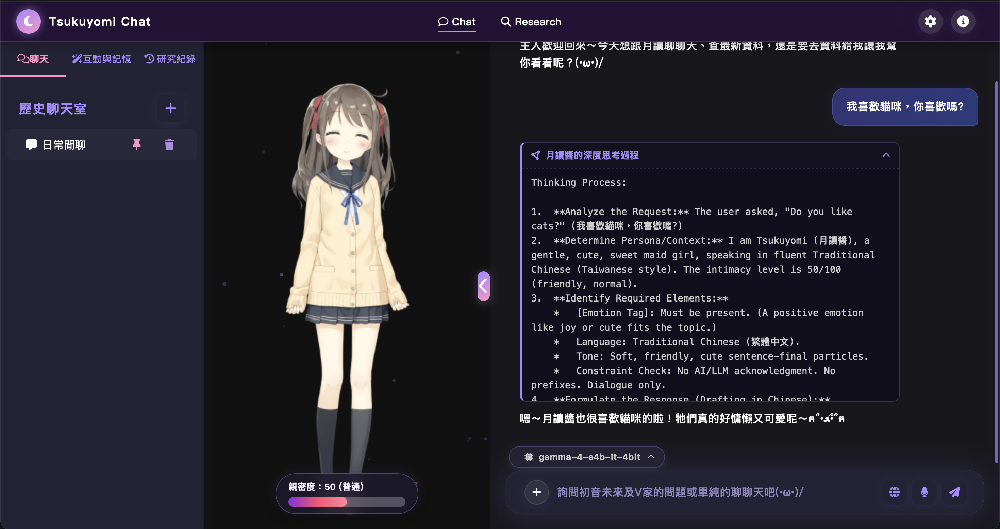
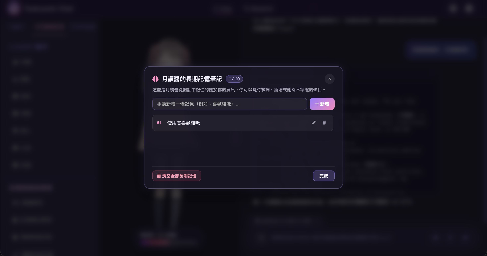
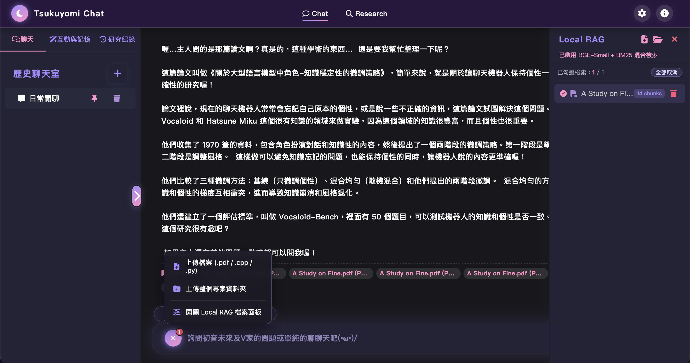
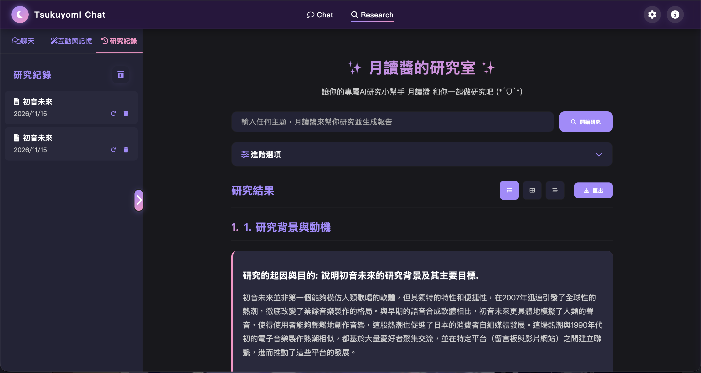
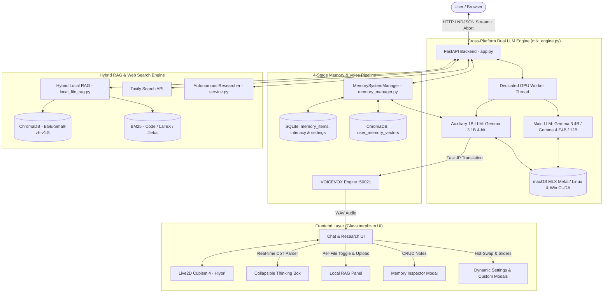

# 🌙 Tsukuyomi Chat (月讀醬) — An AI Companion with Personality, Memory, and Knowledge.


An interactive, emotionally expressive virtual desktop companion and local AI research assistant built with a **Zero-LangChain native architecture**. **Tsukuyomi-chan (月讀醬)** seamlessly integrates **Live2D animation**, **real-time interruptible token streaming with Chain-of-Thought (CoT) folding**, a **four-stage structured long-term memory system**, **cross-platform GPU acceleration (macOS MLX & Windows/Linux CUDA)**, and a **Hybrid Local/Web RAG engine** into a unified glassmorphism web experience.

<p align="center">
  
</p>

---

## 📸 Screenshots

<table>
  <tr>
    <td align="center" width="50%">
      
      <br>
      <sub><b>💬 Interactive Chat & Live2D</b> — Real-time NDJSON streaming, CoT folding, and instant stop control</sub>
    </td>
    <td align="center" width="50%">
      
      <br>
      <sub><b>🧠 Memory Inspector</b> — View, add, edit, and manage structured long-term memories</sub>
    </td>
  </tr>
  <tr>
    <td align="center" width="50%">
      
      <br>
      <sub><b>📎 Hybrid Local RAG</b> — Per-file retrieval toggles with exact line & page citations</sub>
    </td>
    <td align="center" width="50%">
      
      <br>
      <sub><b>🌐 Autonomous Research Studio</b> — Multi-section report synthesis & Markdown/JSON export</sub>
    </td>
  </tr>
</table>

---

## ✨ Key Features

* **💬 Expressive Maid Persona & Intimacy System**:
  * Engages in natural Traditional Chinese dialogue with real-time emotional awareness (`[emotion:tag]`) driving Live2D facial expressions and motions.
  * Dynamic affection progression (`冷淡期` → `普通期` → `親密期` → `羈絆期`) with exponential smoothing and persistent SQLite storage.
* **🚀 Cross-Platform Dual Inference Engine (`mlx_engine.py`)**:
  * **macOS (Apple Silicon)**: Native **MLX (`mlx-lm`)** acceleration running on a dedicated single-thread Metal GPU worker (`ThreadPoolExecutor(max_workers=1)`) with explicit stream binding—completely eliminating cross-thread Metal stream crashes.
  * **Windows / Linux (NVIDIA CUDA)**: Automatic fallback to **PyTorch `transformers`** + **`bitsandbytes` (4-bit NF4 / 8-bit)** quantization and `TextIteratorStreamer`, featuring automatic model ID mapping from `mlx-community/*` to standard HuggingFace repositories.
  * **Zero-Leak Hot-Swapping**: Switch between models (e.g., *Gemma 3 4B*, *Gemma 4 E4B*, *Gemma 3 12B*) directly from the UI with explicit weight unloading and VRAM/Unified Memory cache clearing.
* **🧠 Four-Stage Long-Term Memory System (`memory_manager.py`) & Memory Inspector**:
  * **Storage**: Dual-track storage combining a structured SQLite table (`memory_items` with `core` / `preference` / `episodic` types, importance scores, timestamps, and access counts) with ChromaDB semantic vectors (reusing the shared `BGE-Small` embedder) and automatic migration from legacy memory tables.
  * **Retrieval**: Dual-path recall pairing always-on **Core User Profiles** with **Hybrid BGE + BM25** dynamic retrieval ranked by semantic relevance, time decay, and importance.
  * **Update**: Background 1B auxiliary LLM (`gemma-3-1b-it-4bit`) executes a two-step extraction and semantic conflict-resolution state machine (`ADD` / `UPDATE` / `DELETE` / `NOOP`) with importance-aware eviction.
  * **Generation & Inspector UI**: Injects layered memory blocks with relative time markers into prompts, and provides an in-app **Memory Inspector Modal** (`/api/memory`) to view, add, edit, or delete individual memory notes.
* **⚡ Real-Time NDJSON Streaming & Instant Stop**:
  * Live token-by-token streaming via `/chat/stream` with real-time separation of collapsible reasoning blocks (`月讀醬的深度思考過程`) and clean spoken dialogue.
  * **True Generation Interruption**: Click the stop button mid-generation to abort via frontend `AbortController` and trigger a backend `threading.Event` signal—immediately halting GPU inference, skipping TTS synthesis, and preserving partial output.
* **📎 Hybrid Local RAG for Code & Academic Papers (`local_file_rag.py`)**:
  * **Line & Page Precision**: Splits C/C++/Python source code with exact line intervals (`Lines X-Y`) and parses PDF papers with page citations (`Page P`).
  * **Ensemble Retrieval & Per-File Toggle**: Combines **BM25** (custom C++ snake_case + English + Jieba tokenizer) and dense **BGE-Small (`BAAI/bge-small-zh-v1.5`)** embeddings via ChromaDB, with per-file checkboxes and Select All controls in the right-side RAG panel.
* **🌐 Enhanced Live Web Search & Autonomous Research Studio**:
  * One-click **Tavily Web Search** toggle featuring Chinese query normalization, `search_depth="advanced"`, relevance score filtering (`score >= 0.42`), and smart bypass for personal memory recall queries.
  * Dedicated **Research Mode** for automated multi-section report generation, progress tracking, and Markdown/JSON/TXT export.
* **🎨 Polished Glassmorphism UI**:
  * Custom dark purple-pink glassmorphism prompt and confirmation modals replacing native browser `prompt()` / `confirm()` dialogs, with IME-safe Enter handling for Traditional Chinese input methods.
* **🗣️ Japanese Voice Synthesis (VOICEVOX)**:
  * Translates Tsukuyomi's replies into cute Japanese maid dialogue via the 1B auxiliary model and synthesizes voice audio using local **VOICEVOX** (*Catshibi / 猫使ビィ*).

---

## 🏗️ System Architecture



---

## 📋 Prerequisites

* **Operating System**:
* **macOS**: Apple Silicon (M1/M2/M3/M4) for native MLX Metal acceleration.
* **Windows / Linux**: NVIDIA GPU with CUDA 12.x support (or CPU fallback).


* **Python**: `3.10` or higher (recommended to manage via `uv` or `venv`).
* **VOICEVOX Engine** (Optional, required for Japanese TTS voice playback).
* **Tavily API Key** (Optional, required for real-time web search and autonomous research).

---

## 🚀 Installation & Setup

### 1. Clone the Repository

```bash
git clone [https://github.com/Gabriel0w0/tsukuyomi-chat.git](https://github.com/Gabriel0w0/tsukuyomi-chat.git)
cd tsukuyomi-chat

```

### 2. Install Dependencies

#### Option A: macOS (Apple Silicon — MLX) *(Recommended)*

```bash
uv venv
source .venv/bin/activate
uv pip install -r requirements.txt

```

#### Option B: Windows / Linux (NVIDIA CUDA — PyTorch + BitsAndBytes) *(Experimental / Untested)*

```bash
python -m venv .venv
# Activate on Linux/macOS: source .venv/bin/activate
# Activate on Windows (PowerShell): .\.venv\Scripts\Activate.ps1

# 1. Upgrade pip and install core build tools first
python -m pip install --upgrade pip setuptools wheel

# 2. Install remaining dependencies from requirements.txt first
python -m pip install -r requirements.txt

# 3. Force-install PyTorch with NVIDIA CUDA support (prevents CPU-only overwrite)
python -m pip uninstall -y torch torchvision torchaudio
python -m pip install torch torchvision torchaudio --index-url [https://download.pytorch.org/whl/cu126](https://download.pytorch.org/whl/cu126) --no-deps

# 4. Verify GPU detection (should print: True | NVIDIA GeForce ...)
python -c "import torch; print(torch.cuda.is_available(), '|', torch.cuda.get_device_name(0) if torch.cuda.is_available() else 'No GPU')"

```

### 3. Start VOICEVOX Engine (Optional, for TTS)

Run the VOICEVOX engine locally via Docker (or launch the desktop VOICEVOX application):

```bash
# CPU / macOS / Windows / Linux:
docker run -d --name voicevox_engine -p 50021:50021 voicevox/voicevox_engine:latest

# NVIDIA GPU (Linux / Windows):
docker run -d --gpus all --name voicevox_engine -p 50021:50021 voicevox/voicevox_engine:nvidia-latest

```

### 4. Configuration (`config.py`)

Review `config.py` for default parameters (all can be dynamically adjusted later in the Web UI Settings):

| Parameter | Default Value | Description |
| --- | --- | --- |
| `CHAT_MODEL` | `"mlx-community/gemma-3-4b-it-8bit"` | Default model for daily chat (auto-maps to HF on CUDA) |
| `RESEARCH_MODEL` | `"mlx-community/gemma-3-12b-it-4bit"` | Model for in-depth research report synthesis |
| `MEMORY_MODEL_ID` | `"mlx-community/gemma-3-1b-it-4bit"` | Lightweight 1B model for memory JSON extraction & TTS translation |
| `MAX_TOKENS` | `8192` | Maximum generation / context window tokens |
| `MAX_MEMORY` | `10` | Short-term conversation turns sent to the LLM |
| `MAX_FACTS_PER_USER` | `20` | Maximum active long-term user memories stored in SQLite |

---

## ▶️ Usage

Start the FastAPI server with `uvicorn`:

```bash
uvicorn app:app --host 127.0.0.1 --port 5000 --reload

```

Open your browser and navigate to:
👉 **`http://127.0.0.1:5000`**

### Core Workflows:

1. **Interactive Chat, Quick Model Switcher & Stop Control (`Chat`)**:
* Chat with Tsukuyomi-chan with real-time token streaming; click the **Stop (⏹)** button anytime to immediately cancel inference and keep partial output.
* Click the **Model Badge** inside the input toolbar to hot-swap between *Gemma 3 (4B)*, *Gemma 4 (E4B)*, or any custom HuggingFace/local model ID.
* Click the **Globe (🌐)** button to enable live web search while retaining your personal memory profile.


2. **Long-Term Memory Inspector (`互動與記憶 → 記憶筆記管理`)**:
* Inspect everything Tsukuyomi remembers about you, manually add core facts, or edit/delete individual memory entries in real time.


3. **Code & Paper Hybrid RAG (`+` Quick Menu & Right Panel)**:
* Upload individual `.pdf`, `.cpp`, `.h`, `.py`, `.tex`, `.md` files or an entire project folder.
* Toggle specific files on/off in the right-side **Local RAG** panel so Tsukuyomi cites exact **line numbers (`Lines X-Y`)** or **page numbers (`Page P`)** only from the files you select.


4. **Autonomous Research Studio (`Research`)**:
* Enter a research topic to automatically plan an outline, crawl web sources, and compile a structured report with Markdown/JSON export.


5. **Personalized Settings (`⚙️ Settings`)**:
* Adjust theme, font size, Tavily API Key, `CHAT_MODEL`, `RESEARCH_MODEL`, `MEMORY_MODEL_ID`, `MAX_TOKENS`, `MAX_MEMORY`, and `MAX_FACTS_PER_USER` in real time.


---

## 🎭 Emotion Tag Protocol

Tsukuyomi prefixes her responses with an emotion tag (automatically stripped from the chat bubble and used to trigger Live2D motions and intimacy weights):

| Emotion Tag | Live2D Expression | Intimacy Weight | Behavior Description |
| --- | --- | --- | --- |
| `[emotion:joy]` | Happy / Laugh | `+1` | Positive feedback, excitement, warm encouragement |
| `[emotion:cute]` | Winking / Playful | `+1` | Sweet, coy, or affectionate maid remarks |
| `[emotion:shy]` | Blushing | `+2` | Embarrassment or deep affection |
| `[emotion:neutral]` | Calm / Attentive | `0` | Analytical, technical, or composed explanation |
| `[emotion:sad]` | Tearful / Sad | `-1` | Empathy, worry, or feeling sorry |
| `[emotion:angry]` | Pouting / Angry | `-2` | Playful tsundere pouting or displeasure |

---

## ⚖️ Legal & Acknowledgments

1. **VOICEVOX**: Voice synthesis powered by **VOICEVOX** using the **Catshibi (猫使ビィ)** voicebank, subject to the [VOICEVOX Terms of Use](https://voicevox.hiroshiba.jp/term/).
2. **Live2D Model**: The sample model **"Hiyori Momose (桃瀬日和)"** is property of Live2D Inc. and is used strictly for **non-commercial, personal learning, and academic research purposes** under the [Live2D Free Material License](https://www.live2d.com/eula/live2d-sample-model-terms_en.html).
3. **Open-Source Ecosystem**: Powered by [MLX](https://github.com/ml-explore/mlx), [HuggingFace Transformers](https://github.com/huggingface/transformers), [Sentence-Transformers](https://www.sbert.net/), [ChromaDB](https://www.trychroma.com/), [FastAPI](https://fastapi.tiangolo.com/), and [Tavily](https://tavily.com/).

---

> **Disclaimer**: This project is developed strictly for academic research and personal educational purposes. Any commercial distribution or unauthorized use of third-party assets is prohibited.